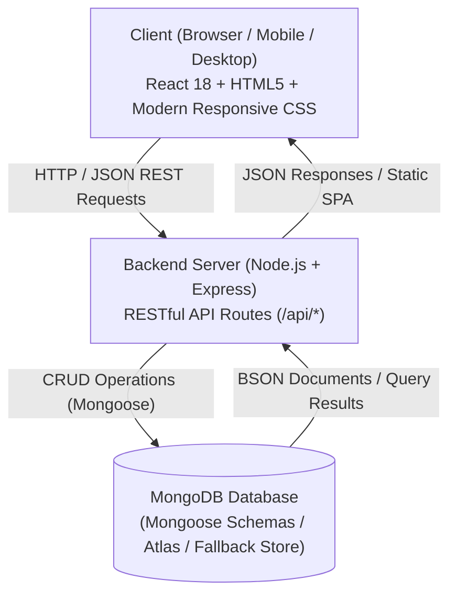

# CareerConnect — Modern Internship & Job Portal
### Full-Stack Web Application (MERN Stack: HTML5, CSS3, JavaScript, ReactJS, NodeJS, ExpressJS, MongoDB)


> **Live Deployment:** [https://internship-job-portal-debatra.vercel.app](https://internship-job-portal-debatra.vercel.app)  
> **GitHub Repository:** [https://github.com/debatranayak111/Web-Application](https://github.com/debatranayak111/Web-Application)  
> **Project Directory:** [https://github.com/debatranayak111/Web-Application/tree/main/internship-job-portal](https://github.com/debatranayak111/Web-Application/tree/main/internship-job-portal)  
> **Author:** Debatra Nayak (`2024091239@gitam.edu`), GITAM Deemed to be University  

---

## 📌 1. Real-World Problem Statement & Objectives

College students and early-career developers frequently face obstacles when launching their careers:
1. **Scattered Opportunities:** Job listings are fragmented across LinkedIn, campus boards, and unorganized email threads.
2. **Application Black Holes:** Students submit resumes with zero visibility into whether hiring managers reviewed, shortlisted, or rejected their profile.
3. **Recruiter Overhead:** Startup founders and engineering managers spend excessive time manually filtering unformatted emails and applicant resumes.

### Solution: CareerConnect
**CareerConnect** is a responsive full-stack MERN application that provides a unified, transparent recruitment ecosystem:
- **For Students:** Discover verified tech internships, filter by category and workplace type (Remote/Hybrid/On-site), apply in one click with custom cover notes, and monitor hiring pipeline progress through a real-time status tracker.
- **For Employers & Recruiters:** Publish detailed internship openings, manage applicant queues, review candidate credentials, and update applicant statuses (`Under Review`, `Shortlisted`, `Interview Scheduled`, `Accepted`, `Rejected`) with personalized feedback notes.

---

## 🌟 2. Key Features

### 🏢 A. Companies Post Job Opportunities
- **Rich Opportunity Creation Modal:** Publish postings specifying title, company name, category, workplace type (Remote, Hybrid, On-site), location, stipend, duration, openings, deadline, required skills tags, key responsibilities, qualifications, and perks.
- **Posting Management (CRUD):** Real-time list of all active company postings with live applicant counters, inline editing, and deletion options.
- **Candidate Reviewer:** Filter applicants by specific job opening, review candidate qualifications, CGPA, college, and custom cover letters.
- **Status Pipeline Controls:** 1-click status transitions with recruiter feedback notes.

### 🎓 B. Students Create & Manage Profiles
- **Academic Credentials:** University/College name, degree, branch, graduation year batch, and CGPA.
- **Dynamic Skills Tag Manager:** Add or remove technical skills (React, Node, Express, MongoDB, Python, Docker) with instant tag updates.
- **Portfolio & Verification Links:** Integration for GitHub profile, LinkedIn, personal website, and resume document URL.
- **Professional Bio:** Editable summary highlighting technical strengths and career interests.

### 🔍 C. Search & Filter Internships
- **Real-Time Keyword Search:** Instant search querying job titles, company names, descriptions, and required technical skills.
- **Multi-Category Filter Pills:** Instant categorization across *Software Engineering*, *Frontend*, *Backend*, *Data Science & AI*, and *UI/UX Design*.
- **Workplace Type Filter:** Select between *All*, *Remote*, *Hybrid*, and *On-site* roles.
- **Dynamic Sorting:** Sort by *Newest First*, *Highest Stipend*, or *Most Popular (Applicant Count)*.

### ⚡ D. 1-Click Application Process
- **Pre-filled Application Modal:** Automatically synchronizes the student's name, verified university email, phone number, college, degree, and skill set.
- **Custom Cover Letter:** Allows candidates to write tailored messages to hiring managers.
- **Duplicate Prevention Guard:** Prevents duplicate submissions for the same position by the same applicant.
- **Instant Visual Feedback:** Toast notifications and automated addition to the student's tracker dashboard.

### 📋 E. Real-Time Application Status Tracker
- **Visual Multi-Stage Pipeline Stepper:**  
  `Applied` ➔ `Under Review` ➔ `Shortlisted` ➔ `Interview Scheduled` ➔ `Decision (Accepted / Rejected)`
- **Color-Coded Status Badges:** Visual clarity on current evaluation stage.
- **Recruiter Feedback Notice:** Candidates view direct interview instructions or status updates written by recruiters.
- **Withdrawal Action:** Students can withdraw active applications at any point before final decision.

---

## 🏗️ 3. System Architecture & Tech Stack



| Layer | Technology | Purpose |
|---|---|---|
| **Frontend** | React 18, HTML5, CSS3, JavaScript (ES6+), Vite | Modern component-based SPA, responsive layout, glassmorphic status badges, real-time UI state. |
| **Backend** | Node.js, Express.js | RESTful routing, CORS configuration, request validation, static SPA file serving. |
| **Database** | MongoDB, Mongoose, Embedded Fallback Store | Schemas with indexing and validations. Features resilient auto-fallback to persistent store so the app works reliably both with and without active MongoDB server! |
| **Deployment** | Vercel (Edge CDN + Serverless Functions) | Single-repository serverless full-stack deployment via `vercel.json`. |

---

## 📸 4. Screenshots & UI Walkthrough

All high-resolution screenshots were captured from the live working application using automated browser automation:

| View | Screenshot Preview |
|---|---|
| **1. Browse Internships & Hero** | `screenshots/screenshot_1_browse_internships.png` |
| **2. Detailed Job Modal & Perks** | `screenshots/screenshot_2_job_details_modal.png` |
| **3. 1-Click Apply Modal** | `screenshots/screenshot_3_apply_modal.png` |
| **4. Live Application Status Tracker** | `screenshots/screenshot_4_application_tracker.png` |
| **5. Student Profile & Skill Tag Manager** | `screenshots/screenshot_5_student_profile.png` |
| **6. Employer Postings Dashboard** | `screenshots/screenshot_6_recruiter_dashboard.png` |
| **7. Recruiter Candidate Reviewer** | `screenshots/screenshot_7_candidate_reviewer.png` |
| **8. Post Opportunity Modal** | `screenshots/screenshot_8_post_job_modal.png` |

---

## 🔌 5. RESTful API Endpoints Documentation

All endpoints return uniform JSON responses: `{ success: true, data: ... }` on success, or `{ success: false, error: ... }` on failure.

### 📌 Jobs API (`/api/jobs`)
| Method | Endpoint | Description | Query Parameters / Body |
|---|---|---|---|
| `GET` | `/api/jobs` | Retrieve all jobs | `q`, `category`, `workplaceType`, `minStipend`, `sortBy` |
| `GET` | `/api/jobs/:id` | Retrieve single job with applicant count | `:id` (Job ID) |
| `POST` | `/api/jobs` | Create new job opportunity | JSON body with `title`, `company`, `stipend`, `skills`, etc. |
| `PUT` | `/api/jobs/:id` | Update existing job opportunity | JSON body with updated fields |
| `DELETE` | `/api/jobs/:id` | Delete job opportunity & its applications | `:id` (Job ID) |
| `GET` | `/api/jobs/meta/categories` | Retrieve distinct categories | None |

### 📌 Student Profile API (`/api/students`)
| Method | Endpoint | Description | Query Parameters / Body |
|---|---|---|---|
| `GET` | `/api/students/profile` | Retrieve student profile | `?email=2024091239@gitam.edu` |
| `PUT` | `/api/students/profile` | Create or update student profile | JSON body (`fullName`, `skills`, `cgpa`, `github`, etc.) |

### 📌 Applications API (`/api/applications`)
| Method | Endpoint | Description | Query Parameters / Body |
|---|---|---|---|
| `GET` | `/api/applications` | Retrieve all applications | `?studentEmail=...` or `?jobId=...` |
| `GET` | `/api/applications/student/:email` | Retrieve applications for specific student | `:email` |
| `GET` | `/api/applications/job/:jobId` | Retrieve candidates for a specific job | `:jobId` |
| `POST` | `/api/applications` | Submit new application (apply for job) | JSON body (`jobId`, `studentEmail`, `coverLetter`, etc.) |
| `PATCH` | `/api/applications/:id/status` | Update candidate status (Recruiter) | JSON body (`status`, `feedback`) |
| `DELETE` | `/api/applications/:id` | Withdraw application (Student) | `:id` (Application ID) |

### 📌 Stats & Health API (`/api`)
| Method | Endpoint | Description |
|---|---|---|
| `GET` | `/api/stats` | High-level metrics: Total jobs, applications, shortlisted, hiring companies |
| `GET` | `/api/health` | Server uptime, database mode, and connection status |

---

## 🗄️ 6. MongoDB Schema Design

### Job Schema (`server/models/Job.js`)
```javascript
{
  title: { type: String, required: true },
  company: { type: String, required: true },
  companyLogo: { type: String, default: '' },
  companyInitials: { type: String, default: 'CO' },
  location: { type: String, required: true, default: 'Remote' },
  workplaceType: { type: String, enum: ['Remote', 'Hybrid', 'On-site'], default: 'Remote' },
  employmentType: { type: String, enum: ['Internship', 'Full-time', 'Part-time'], default: 'Internship' },
  category: { type: String, required: true },
  stipend: { type: String, required: true },
  stipendNumeric: { type: Number, default: 0 },
  duration: { type: String, default: '3 Months' },
  openings: { type: Number, default: 1 },
  skills: { type: [String], default: [] },
  description: { type: String, required: true },
  responsibilities: { type: [String], default: [] },
  requirements: { type: [String], default: [] },
  perks: { type: [String], default: [] },
  postedBy: { type: String, required: true },
  deadline: { type: String },
  status: { type: String, enum: ['Active', 'Closed'], default: 'Active' },
  timestamps: true
}
```

### Application Schema (`server/models/Application.js`)
```javascript
{
  jobId: { type: String, required: true, ref: 'Job' },
  jobTitle: { type: String, required: true },
  companyName: { type: String, required: true },
  studentId: { type: String, default: '' },
  studentName: { type: String, required: true },
  studentEmail: { type: String, required: true, lowercase: true },
  studentPhone: { type: String, default: '' },
  studentCollege: { type: String, default: '' },
  studentDegree: { type: String, default: '' },
  studentSkills: { type: [String], default: [] },
  coverLetter: { type: String, default: '' },
  status: {
    type: String,
    enum: ['Applied', 'Under Review', 'Shortlisted', 'Interview Scheduled', 'Accepted', 'Rejected'],
    default: 'Applied'
  },
  feedback: { type: String, default: 'Application under review.' },
  appliedAt: { type: Date, default: Date.now },
  timestamps: true
}
```

---

## 💻 7. Local Setup & Execution Guide

### Prerequisites
- **Node.js**: v18.0.0 or higher (v24+ recommended)
- **Git**: Installed and configured

### Step 1: Clone the Repository
```bash
git clone https://github.com/debatranayak111/Web-Application.git
cd Web-Application/internship-job-portal
```

### Step 2: Install Dependencies
```bash
npm install
```

### Step 3: Configure Environment Variables (Optional)
Create a `.env` file in `internship-job-portal/` (or copy `.env.example`):
```env
# Optional: Connect to your MongoDB Atlas cluster
# If left blank, the app runs automatically in MongoDB-compatible local storage mode!
MONGODB_URI=mongodb+srv://<username>:<password>@cluster0.mongodb.net/careerconnect?retryWrites=true&w=majority
PORT=5000
NODE_ENV=development
```

### Step 4: Build Frontend Assets
```bash
npm run build
```

### Step 5: Start the Full-Stack Application
```bash
npm start
```
Open your browser and navigate to:
```
http://localhost:5000
```
Both the React frontend and the Express REST APIs are served concurrently from port 5000!

---

## 🚀 8. Deployment Guide for Vercel

CareerConnect is pre-configured for **1-click Vercel deployment** via `vercel.json` and serverless API routing (`api/index.js`).

### Option 1: Deploy via Vercel Web Dashboard (Recommended)
1. Push your repository to GitHub:
   ```bash
   git add .
   git commit -m "Deploy: Full-Stack Internship & Job Portal"
   git push origin main
   ```
2. Log in to [Vercel](https://vercel.com) using your GitHub account.
3. Click **"Add New Project"** ➔ Select the `Web-Application` repository.
4. In the Project Configuration:
   - **Root Directory:** Set to `internship-job-portal` (click *Edit* and select the directory).
   - **Framework Preset:** Vite (auto-detected).
   - **Build Command:** `npm run build`
   - **Output Directory:** `dist`
5. (Optional) In **Environment Variables**, add:
   - `MONGODB_URI`: Your MongoDB Atlas connection string.
6. Click **Deploy**. Vercel will build the frontend assets, configure serverless API endpoints at `/api/*`, and assign a live production URL!

### Option 2: Deploy via Vercel CLI
```bash
npm install -g vercel
cd internship-job-portal
vercel --prod
```

---

## 📁 9. Project Directory Structure

```
internship-job-portal/
├── api/
│   └── index.js                   # Vercel serverless function entrypoint (exports Express app)
├── dist/                          # Production-optimized Vite React build
│   ├── index.html
│   └── assets/
│       ├── index-*.js
│       └── index-*.css
├── public/                        # Static public assets
├── screenshots/                   # Automated high-resolution application screenshots
│   ├── screenshot_1_browse_internships.png
│   ├── screenshot_2_job_details_modal.png
│   ├── screenshot_3_apply_modal.png
│   ├── screenshot_4_application_tracker.png
│   ├── screenshot_5_student_profile.png
│   ├── screenshot_6_recruiter_dashboard.png
│   ├── screenshot_7_candidate_reviewer.png
│   └── screenshot_8_post_job_modal.png
├── server/
│   ├── models/                    # Mongoose Schemas & Validation
│   │   ├── Job.js                 # Job Opportunity Schema
│   │   ├── Student.js             # Student Profile Schema
│   │   └── Application.js         # Job Application Schema
│   ├── routes/                    # RESTful Express Route Handlers
│   │   ├── jobs.js                # /api/jobs (CRUD)
│   │   ├── students.js            # /api/students (Profile CRUD)
│   │   ├── applications.js        # /api/applications (Apply, Status CRUD)
│   │   └── stats.js               # /api/stats & /api/health
│   ├── storage/                   # Database Layer & Resilient Fallback Engine
│   │   ├── db.js                  # Dual-mode MongoDB / Persistent store adapter
│   │   ├── db-store.json          # Persistent JSON fallback data store
│   │   └── initialData.js         # Pre-seeded real-world tech internship listings
│   └── server.js                  # Express backend application & static SPA server
├── src/                           # React 18 Frontend Source Code
│   ├── components/                # Modular React Components
│   │   ├── ApplicationTracker.jsx # Real-time hiring pipeline visual stepper
│   │   ├── ApplyModal.jsx         # 1-click apply dialog with auto-filled profile
│   │   ├── Hero.jsx               # Hero banner with dynamic portal statistics
│   │   ├── JobCard.jsx            # Opportunity card with stipend and skills
│   │   ├── JobDetailModal.jsx     # Comprehensive role details, perks & requirements
│   │   ├── Navbar.jsx             # Sticky navigation & Student/Employer role switcher
│   │   ├── PostJobModal.jsx       # Employer job creation modal with validation
│   │   ├── RecruiterDashboard.jsx # Employer postings & candidate status reviewer
│   │   ├── SearchFilters.jsx      # Real-time search & category filter pills
│   │   ├── StudentProfile.jsx     # Student profile & interactive skill manager
│   │   └── Toast.jsx              # Floating notification feedback system
│   ├── services/
│   │   └── api.js                 # Unified fetch API client
│   ├── App.jsx                    # Core application orchestrator & state manager
│   ├── index.css                  # Responsive design tokens, cards, and animations
│   └── main.jsx                   # React root mount
├── .env.example                   # Environment configuration template
├── .gitignore                     # Git exclusion rules
├── capture_portal_screens.cjs     # Automated Puppeteer screenshot generator
├── index.html                     # HTML5 entrypoint with Google Fonts
├── package.json                   # Project scripts and dependencies
├── vercel.json                    # Vercel serverless routing configuration
├── vite.config.js                 # Vite build & local API proxy configuration
└── README.md                      # Comprehensive project documentation
```

---

## 🎓 10. Submission Metadata

- **Student Name:** Debatra Nayak
- **Registration / Roll No:** 2024091239
- **University:** GITAM Deemed to be University, Visakhapatnam
- **Course:** Web Application Development (WAD) Lab
- **Assignment:** Capstone Full-Stack Web Application (HTML, CSS, JavaScript, ReactJS, NodeJS, ExpressJS, MongoDB)
- **Repository:** [https://github.com/debatranayak111/Web-Application](https://github.com/debatranayak111/Web-Application)
- **Deployment URL:** [https://internship-job-portal-debatra.vercel.app](https://internship-job-portal-debatra.vercel.app)
